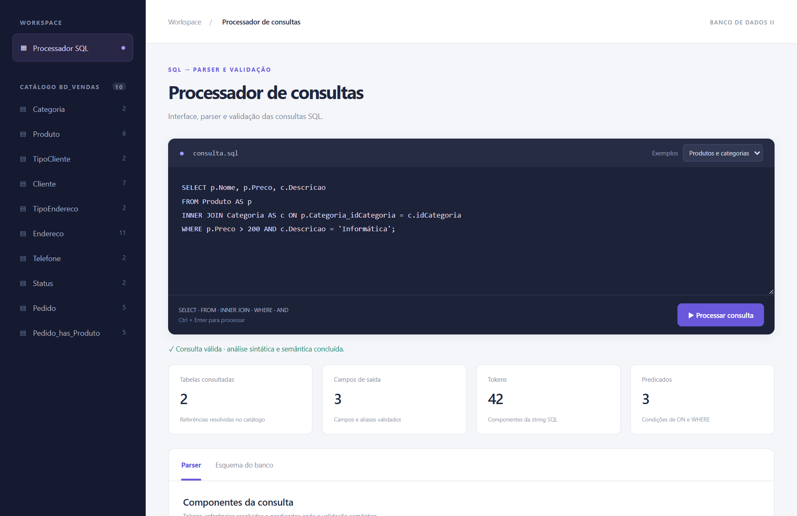
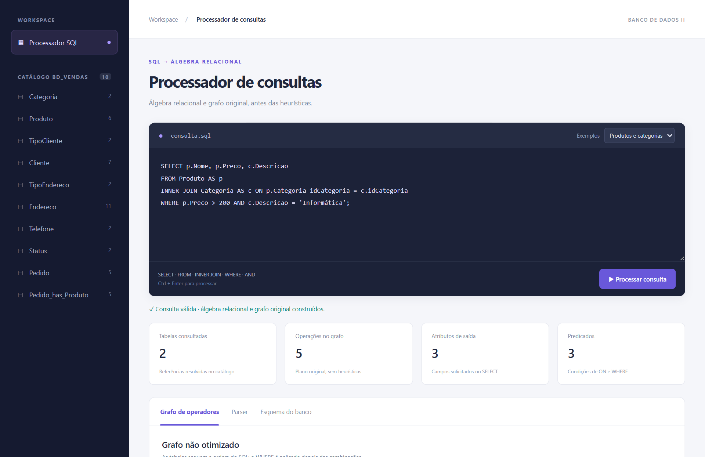
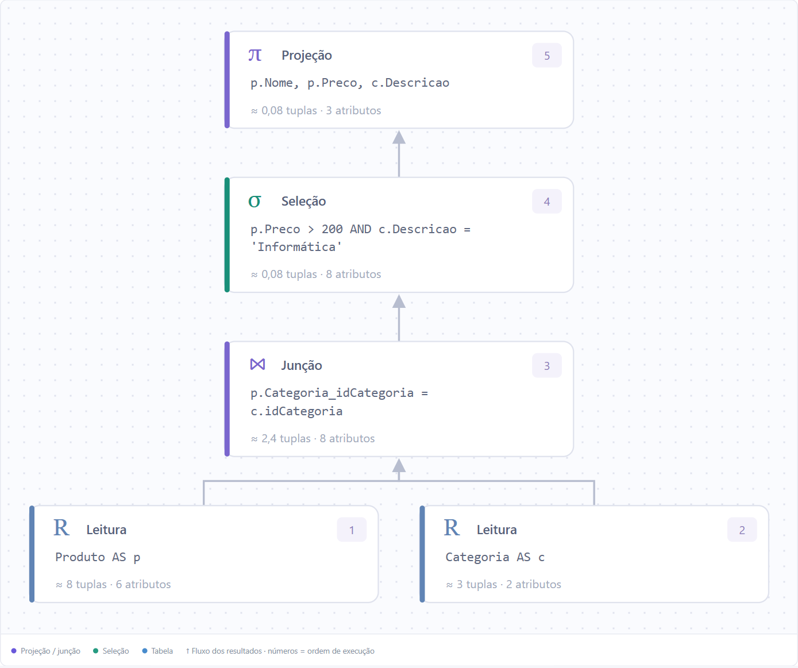

# Mudanças da entrega 1 para a entrega 2

## 1 Visão geral e versões comparadas

O avanço da entrega 2 é transformar a consulta já analisada e validada em **um plano relacional original e uma expressão de álgebra relacional**. A interface passa a apresentar esse plano como um grafo interativo. O parser e a validação da entrega 1 continuam sendo a base do processamento.

Este documento explica o código, a função de cada componente, o que muda na tela e como demonstrar os requisitos de 20/10/2026. A comparação foi conferida em 19/10/2026 usando as versões atuais, após a remoção da marca visual e do card de etapas.

| Referência | Entrega 1 | Entrega 2 |
| --- | --- | --- |
| Branch | `entrega-1` | `entrega-2` |
| Commit examinado | `8f231d3ab81fbe91615906121a46a8b5c48ca81d` | `158cfd7bc6ab5a1916c68abba5bed9d306e14e48` |
| Prazo do cronograma | 15/10/2026 | 20/10/2026 |
| Responsabilidade principal | Interface, parsing e validação | Acrescentar álgebra e grafo não otimizado |
| Saída de `process_query` | Consulta validada e identificação do backend | Consulta validada, plano original, álgebra e backend |
| Testes executados nesta comparação | 22 aprovados | 24 aprovados |

**A entrega 2 constrói e descreve o plano; não executa os registros.** O número dos operadores indica uma ordem de dependência, e as tuplas mostradas com `≈` são estimativas. Não existem nessa branch os modos Otimizado e Comparar, a aba Resultados ou o módulo `consulta/executor.py`.

O fluxo da entrega 1 é: editor SQL → API Python → parser → validação → apresentação da estrutura. Na entrega 2, o fluxo continua com: construção do plano → geração da álgebra → apresentação do grafo e dos detalhes dos operadores.

---

## 2 Interface da entrega 1 e conteúdo de cada área



Captura real da entrega 1, com o exemplo Produtos e categorias. O recorte mostra o cabeçalho, o editor, os indicadores e a navegação da análise; não representa a página inteira.

**Barra lateral e catálogo.** Lista as dez tabelas de BD_Vendas. O número ao lado de cada tabela é a quantidade de campos do esquema, não a quantidade de registros. Clicar em uma tabela abre a área Esquema do banco e destaca sua definição. O catálogo vem de `data/catalog.json`, carregado por `consulta/schema.py`.

**Editor SQL e exemplos.** O campo recebe a string da consulta. O seletor carrega exemplos do backend, e o botão Processar consulta ou Ctrl+Enter envia o texto para `POST /api/process`. Essas ações são controladas por `initialize`, `requestJson` e `run`, em `app.js`.

**Status e erros.** Uma consulta aceita mostra que a análise sintática e semântica foi concluída. Quando há um comando ou campo inválido, a interface mostra a mensagem, linha e coluna e posiciona a seleção no editor. Esse comportamento depende de `QueryError` e do tratamento HTTP já presentes na primeira entrega.

**Indicadores.** Para o exemplo capturado, aparecem 2 tabelas, 3 campos de saída, 42 tokens e 3 predicados. Os valores descrevem a entrada validada; não são resultados de execução da consulta.

**Abas.** A entrega 1 possui Parser e Esquema do banco. Parser é a aba inicial: mostra os campos resolvidos, as tabelas e aliases, os predicados ON/WHERE e os tokens com suas posições. A aba Esquema do banco mostra os campos válidos e as contagens dos registros fictícios usados nas demonstrações.

---

## 3 Mudanças visíveis na interface da entrega 2



Captura real da entrega 2 usando a mesma consulta. Manter a entrada igual permite comparar os indicadores sem atribuir diferenças à escolha de outro exemplo.

| Área | Entrega 1 | Entrega 2 |
| --- | --- | --- |
| Texto acima do título | SQL → PARSER E VALIDAÇÃO | SQL → ÁLGEBRA RELACIONAL |
| Descrição | Interface, parser e validação das consultas SQL | Álgebra relacional e grafo original, antes das heurísticas |
| Aba inicial | Parser | Grafo de operadores |
| Abas disponíveis | Parser e Esquema do banco | Grafo de operadores, Parser e Esquema do banco |
| Segundo indicador | Campos de saída: 3 | Operações no grafo: 5 |
| Terceiro indicador | Tokens: 42 | Atributos de saída: 3 |
| Primeiro e quarto indicadores | Tabelas consultadas e Predicados | Mantidos: 2 tabelas e 3 predicados |
| Mensagem de sucesso | Análise sintática e semântica concluída | Álgebra relacional e grafo original construídos |

O número de tokens continua disponível dentro da aba Parser; ele deixa apenas de ocupar um indicador do painel principal. O indicador Atributos de saída usa `analysis.original.root.width`, calculado com os campos distintos do nó final. Se o SELECT repetir o mesmo campo, essa largura pode diferir do total de posições solicitadas no SELECT.

Em `index.html`, a nova aba recebe `id="tab-graph"` e `data-tab="graph"`. O painel passa a ter `aria-labelledby="tab-graph"`. Em `app.js`, `activeTab` muda de `parser` para `graph`, e `renderPanel` passa a encaminhar essa escolha para `renderGraph`.

**Mudanças comuns às duas versões.** A marca Consulta, o card de etapas, a aba Entregas e o botão de exportação da análise já foram retirados de ambas. Essas remoções não são uma novidade específica da entrega 2. As capturas e este texto refletem a interface atual, não as telas antigas do projeto completo.

---

## 4 Grafo de operadores e leitura de cada parte



O grafo começa visualmente nas leituras da parte inferior. As setas sobem até a projeção final. A captura destaca o plano original da consulta Produtos e categorias. A expressão de álgebra aparece abaixo do grafo na aplicação e é explicada nas seções 7 e 8 deste documento.

| Operador | Tipo no JSON | Função no plano |
| --- | --- | --- |
| R Leitura | `scan` | Representa a relação de entrada e seus campos qualificados pelo alias |
| σ Seleção | `select` | Representa filtros de comparação, como `p.Preco > 200` |
| π Projeção | `project` | Define os campos que permanecem na saída |
| ⋈ Junção | `join` | Combina relações usando predicados do ON |
| × Produto cartesiano | `cross` | Representa todas as combinações quando a combinação não tem predicado |

Cada caixa mostra o símbolo, o nome da operação, um número de ordem, a tabela ou expressão, a quantidade estimada de tuplas e a largura em atributos. A cor diferencia categorias de operadores; a expressão e os atributos completos podem ser consultados clicando no nó ou usando Enter/Espaço quando ele está em foco.

A área de detalhes do nó clicado apresenta o nome, o predicado ou os campos, a lista de atributos e a estimativa. A inspeção da junção, conferida na interface, mostrou 8 atributos e estimativa de 2,4 tuplas. Isso não corresponde à medição de um resultado executado.

---

## 5 Código preservado e mudança no processamento

O esquema, os registros fictícios, o parser, o servidor e o CSS têm o mesmo conteúdo nas duas versões comparadas. A segunda entrega reaproveita a infraestrutura em vez de substituir a validação existente.

| Componente preservado | Função |
| --- | --- |
| `data/catalog.json` | Define as dez tabelas, seus campos, amostras e exemplos SQL |
| `consulta/schema.py` | Expõe `SCHEMA`, `SAMPLE_DATA`, `EXAMPLES` e os metadados da interface |
| `consulta/parser.py` | Reconhece tokens, monta a AST e resolve referências com `validate` |
| `server.py` | Atende os arquivos da interface e as rotas locais da API Python |

Em `consulta/processor.py`, a entrega 1 valida a string, prepara os rótulos dos predicados e retorna somente a consulta e o backend:

```python
query = validate(parse(sql))
# Os predicados ON e WHERE são reunidos e seus rótulos são preparados.
return {"query": query, "backend": "Python"}
```

Na entrega 2, são importadas `build_plan` e `relational_algebra`. O fluxo acrescenta a construção do plano e a nova resposta:

```python
def process_query(sql, data=None):
    query = validate(parse(sql))
    original = build_plan(query, data)
    # A preparação de predicateLabels permanece entre estas etapas.
    return {
        "query": query,
        "original": original,
        "algebra": {"original": relational_algebra(original["root"])},
        "backend": "Python",
    }
```

Os comentários dos dois trechos indicam linhas omitidas para destacar a diferença; eles não foram adicionados ao código do projeto. O parâmetro opcional `data` permite fornecer amostras para as estimativas, sem iniciar uma execução dos operadores.

---

## 6 Novo módulo planner e construção do plano original

`consulta/planner.py` é o único módulo de aplicação novo entre as duas entregas. A versão examinada tem 93 linhas e concentra os tipos de operadores, seus rótulos, a ordem de dependência e a representação algébrica.

**`SYMBOLS`, `NAMES` e `node_label`.** Os dicionários associam tipos como `select` a σ e Seleção. `node_label` descreve a tabela com alias, os campos da projeção ou os predicados. Assim o Python já envia os textos usados no desenho.

**`factor` e `restriction`.** `factor` associa igualdade a 0,10, `<>` a 0,90 e comparações de faixa a 0,33. `restriction` multiplica os fatores dos predicados. Nesta entrega, esses cálculos servem para estimar cardinalidades; eles não escolhem uma ordem diferente para as tabelas ou os filtros.

**Construtores internos de `build_plan`.** `node` gera identificadores `n1`, `n2` e assim por diante. `scan` usa o catálogo e a quantidade de registros da amostra. `select` mantém os campos e aplica a restrição estimada. `project` escolhe os campos sem mudar a estimativa de linhas. `combine` cria `join` quando recebe predicados, ou `cross` quando não recebe, e reúne as colunas dos dois filhos.

O encadeamento central é o seguinte, apenas com quebras de linha ajustadas para leitura:

```python
root = scan(query["tables"][0])
for index, table in enumerate(query["tables"][1:]):
    root = combine(
        root,
        scan(table),
        comparisons(query["joins"][index]["condition"]),
    )
if query["where"]:
    root = select(root, comparisons(query["where"]))
root = project(root, [column["key"] for column in query["columns"]], True)
```

O plano segue a ordem das tabelas do SQL, aplica as condições do ON nas combinações, coloca o WHERE depois dessas combinações e termina com a projeção do SELECT. A presença de σ e π no plano é necessária para representar a consulta; ela não significa que as heurísticas de antecipação já foram aplicadas.

---

## 7 Ordem dos operadores e geração da álgebra

### execution_order

O percurso em pós-ordem faz com que os filhos apareçam antes do pai. A função é iterativa: usa uma pilha e uma marca indicando se as dependências já foram visitadas.

```python
order = []
stack = [(root, False)]
while stack:
    node, visited = stack.pop()
    if visited:
        order.append(node)
    else:
        stack.append((node, True))
        stack.extend((child, False) for child in reversed(node["children"]))
return order
```

No fim de `build_plan`, essa ordem é numerada a partir de 1. Cada operador recebe `label`, `symbol`, `name`, `step` e `width`. A largura é a quantidade de campos distintos do nó. O retorno contém `root`, `optimized: False`, `notes` e `order`.

### relational_algebra

A função percorre a mesma pós-ordem e guarda a expressão de cada nó em um dicionário indexado por identificador. Ao chegar ao pai, as expressões dos filhos já estão disponíveis.

- Uma leitura sem alias diferente usa o nome da tabela. Quando o alias difere, aplica a notação de renomeação `ρ[alias](Tabela)`.
- Seleção e projeção envolvem a expressão do único filho: `σ[predicado](filho)` ou `π[campos](filho)`.
- Junção e produto combinam as expressões dos dois filhos. Só a junção acrescenta predicados junto ao símbolo.

Exemplo efetivamente devolvido pela API para `SELECT Nome FROM Produto WHERE Preco > 200`:

```text
π[Produto.Nome](σ[Produto.Preco > 200](Produto))
```

Leia de dentro para fora: a relação Produto é a entrada; a seleção representa o filtro de preço; a projeção define o campo Nome. A ordem está pronta para ser apresentada, mas nenhuma lista de linhas resultantes é produzida nesta etapa.

---

## 8 Exemplo completo com INNER JOIN

O exemplo Produtos e categorias é carregado automaticamente nas duas interfaces:

```sql
SELECT p.Nome, p.Preco, c.Descricao
FROM Produto AS p
INNER JOIN Categoria AS c ON p.Categoria_idCategoria = c.idCategoria
WHERE p.Preco > 200 AND c.Descricao = 'Informática';
```

Na entrega 1, a resposta explica a estrutura: 2 tabelas, 3 campos solicitados, 42 tokens e 3 predicados. Na entrega 2, essa mesma estrutura alimenta os cinco operadores abaixo.

| Passo | Operação e conteúdo | Estimativa de tuplas | Atributos |
| --- | --- | --- | --- |
| 1 | Leitura de Produto AS p | 8 | 6 |
| 2 | Leitura de Categoria AS c | 3 | 2 |
| 3 | Junção pelo vínculo das categorias no ON | 2,4 | 8 |
| 4 | Seleção pelos dois predicados do WHERE | 0,0792 | 8 |
| 5 | Projeção de p.Nome, p.Preco e c.Descricao | 0,0792 | 3 |

Os cálculos são `8 × 3 × 0,10 = 2,4` para a junção e `2,4 × 0,33 × 0,10 = 0,0792` para os filtros. A interface arredonda o último valor para aproximadamente 0,08. Uma estimativa fracionária não significa que existe uma fração de registro, nem que foram contadas linhas na execução.

A expressão devolvida pelo Python, aqui quebrada em linhas sem mudar os operadores, é:

```text
π[p.Nome, p.Preco, c.Descricao](
  σ[p.Preco > 200 AND c.Descricao = 'Informática'](
    (ρ[p](Produto) ⋈[p.Categoria_idCategoria = c.idCategoria]
      ρ[c](Categoria))
  )
)
```

O WHERE permanece acima da junção. Não há seleção local empurrada para Produto ou Categoria, nem projeção antecipada reduzindo os campos antes da combinação. Essas transformações pertencem à etapa seguinte do cronograma.

---

## 9 Exemplo com produto cartesiano e estrutura da resposta

O exemplo Junção no WHERE evidencia o significado de grafo não otimizado:

```sql
SELECT p.Nome, c.Descricao
FROM Produto p, Categoria c
WHERE p.Categoria_idCategoria = c.idCategoria AND p.Preco < 300;
```

Como as tabelas estão separadas por vírgula, a combinação não recebe uma condição ON. `combine` cria `cross`. A condição entre as tabelas fica dentro da seleção posterior do WHERE.

```text
scan Produto → scan Categoria → cross → select → project
```

Essa linha descreve a sequência da lista `order`, não setas diretas de dependência entre todos os nós: as duas leituras são filhos do produto. A estimativa do produto é 24 tuplas e 8 atributos; após a seleção, passa a 0,792 tuplas e, na projeção final, a 2 atributos. A entrega 2 mantém ×; convertê-lo em ⋈ nessa etapa mudaria o escopo planejado para as próximas entregas.

| Parte da resposta | Conteúdo e utilidade |
| --- | --- |
| `query` | AST validada, tokens e `predicateLabels`, também usados na aba Parser |
| `original.root` | Nó final que referencia os filhos e permite percorrer o grafo |
| `original.order` | Lista em pós-ordem usada na numeração e na inspeção |
| `original.optimized` | Valor `false`, identificando o plano original |
| `original.notes` | Notas sobre ordem das tabelas, WHERE posterior e projeção final |
| `algebra.original` | String com a expressão relacional produzida no Python |
| `backend` | Identificação `Python` |

Um nó possui `id`, `type`, `children`, `columns`, `estimatedRows` e os dados específicos da operação, como `table`, `alias` ou `predicates`. Depois recebe rótulo, símbolo, nome, passo e largura. Não existem no nível principal dessa resposta `optimized`, `optimizedResult`, `originalResult` ou `verified`.

---

## 10 Código da interface e ligação com o backend

**Inicialização e requisições.** `initialize` obtém catálogo e exemplos em `/api/catalog`, carrega a consulta inicial e chama `run`. `run` envia o SQL, trata sucesso ou erro e atualiza métricas e painel. `requestSequence` impede que uma resposta antiga substitua a análise de uma requisição mais recente. Essas funções já existem na entrega 1.

**Métricas e seleção de abas.** `renderMetrics` passa a usar o total de nós em `analysis.original.order.length` e a largura em `analysis.original.root.width`. O novo encaminhamento de `renderPanel` é:

```javascript
if (activeTab === 'graph') renderGraph();
else if (activeTab === 'parser') renderParser();
```

**`wrap`.** Divide rótulos em linhas para caberem nas caixas. Rótulos muito extensos são abreviados no desenho; o título do nó e sua inspeção mantêm a informação completa.

**`graphSvg`.** Percorre `plan.root`, posiciona os filhos abaixo do pai, distribui as folhas horizontalmente e calcula as dimensões das caixas. Em seguida desenha as linhas com setas e os grupos SVG com texto e atributos de acessibilidade. A lista `plan.order` fornece a numeração pronta.

**`renderGraph`.** Usa `analysis.original`, desenha o grafo e coloca `analysis.algebra.original` abaixo dele. A inspeção localiza o identificador recebido no clique e mostra o nó correspondente:

```javascript
const node = plan.order.find(node => node.id === element.dataset.node);
$('#node-details').hidden = false;
```

O conteúdo mostrado usa `node.symbol`, `node.name`, `node.label`, `node.columns` e `node.estimatedRows`. Eventos de clique e de teclado chamam a mesma inspeção. Não há nova requisição para calcular o operador: os dados já vieram da API.

**Divisão de responsabilidades.** O Python decide quais operadores existem, como se ligam e qual é a álgebra. O JavaScript decide as coordenadas visuais, mostra textos, troca abas e responde a cliques. A inclusão do desenho SVG não transfere a lógica SQL para JavaScript.

---

## 11 Arquivos modificados e testes que comprovam a mudança

O comando `git diff --name-status entrega-1..entrega-2` identifica oito arquivos diferentes nas versões examinadas:

| Arquivo | Mudança na entrega 2 |
| --- | --- |
| `consulta/planner.py` | Novo módulo de operadores, plano original, ordem e álgebra |
| `consulta/processor.py` | Acrescenta planejamento e novas partes da resposta |
| `app.js` | Acrescenta o desenho, a inspeção e a atualização das métricas e abas |
| `index.html` | Altera os textos de contexto e inclui a aba do grafo |
| `tests/test_processor.py` | Substitui a verificação de ausência de plano por três verificações do plano original |
| `tests/test_server.py` | Exige `original.order` e `algebra.original` na resposta HTTP |
| `README.md` | Atualiza execução, demonstração e escopo da versão |
| `ENTREGA.md` | Explica os algoritmos e requisitos específicos da segunda entrega |

**Três verificações do planejador.** `test_original_plan_keeps_cross_and_where_above_it` exige os tipos `scan, scan, cross, select, project`, a ordem p/c e a presença de ×. `test_inner_join_and_final_projection` confere o uso de `join` e a lista de campos do nó final. `test_original_plan_dependencies_and_labels` verifica que cada filho vem antes do pai, os passos são consistentes e os rótulos foram preparados.

O teste da entrega 1 `test_first_delivery_does_not_build_a_plan` exigia apenas as chaves `query` e `backend`. Ao substituir esse teste por três testes do novo comportamento, o total aumenta em dois: de 22 para 24. As validações de tabelas, campos, aliases, tipos de entrada, Unicode, precisão de inteiros e erros HTTP continuam cobertas.

Os testes das duas branches foram executados novamente durante a preparação deste documento. Também foram consultados os três exemplos pela API, capturadas as interfaces e conferida a inspeção de uma junção. Nenhum erro JavaScript foi observado nas duas páginas capturadas.

---

## 12 Roteiro de demonstração e referências do código

Para apresentar a primeira versão, encerre um servidor anterior antes de trocar de branch e execute:

```powershell
git switch entrega-1
.\iniciar.cmd
```

Mostre o editor, carregue Produtos e categorias e abra Parser. Explique os campos, aliases, tokens, predicados e catálogo. Demonstre a rejeição de `SELECT Nome, Valor FROM Produto` e de `DELETE FROM Produto`. Essa parte pode ficar com a Pessoa 1.

Em seguida, encerre o servidor com Ctrl+C e inicie a entrega 2:

```powershell
git switch entrega-2
.\iniciar.cmd
```

A Pessoa 2 pode usar a mesma consulta para mostrar a nova aba, os 5 operadores, as estimativas, a expressão algébrica e a inspeção da junção. Depois, carregue Junção no WHERE e explique por que × permanece no plano original. Mostre `processor.py` e a sequência central de `build_plan` para ligar cada mudança da tela ao código.

Para repetir os testes na branch selecionada, use `python -B -m unittest discover -s tests -v` ou `.\testar.cmd`. A aplicação requer Python 3.10 ou superior, apenas com a biblioteca padrão. MySQL é opcional e não foi utilizado nas verificações deste documento.

**Limite da apresentação.** Não atribua execução dos registros, contagens reais de resultados, antecipação de seleção/projeção ou reordenação de junções à entrega 2. O alvo de 20/10 é a conversão para álgebra relacional e o grafo não otimizado. Os mesmos símbolos podem aparecer nas etapas seguintes, mas a posição dos operadores e o processamento disponível é que distinguem as versões.

Referências fixadas nos commits efetivamente examinados:

- [Processamento na entrega 1](https://github.com/JoeyAlanS/processador-consultas/blob/8f231d3ab81fbe91615906121a46a8b5c48ca81d/consulta/processor.py).
- [Processamento na entrega 2](https://github.com/JoeyAlanS/processador-consultas/blob/158cfd7bc6ab5a1916c68abba5bed9d306e14e48/consulta/processor.py#L7).
- [Planejador da entrega 2](https://github.com/JoeyAlanS/processador-consultas/blob/158cfd7bc6ab5a1916c68abba5bed9d306e14e48/consulta/planner.py#L59).
- [Desenho e inspeção na interface](https://github.com/JoeyAlanS/processador-consultas/blob/158cfd7bc6ab5a1916c68abba5bed9d306e14e48/app.js#L121).
- [Testes do plano original](https://github.com/JoeyAlanS/processador-consultas/blob/158cfd7bc6ab5a1916c68abba5bed9d306e14e48/tests/test_processor.py#L72).

As capturas são das duas branches atuais, com o mesmo exemplo carregado. A organização deste documento não altera o código de nenhuma entrega. Os prazos são os do cronograma fornecido; os commits conservam suas datas reais.
